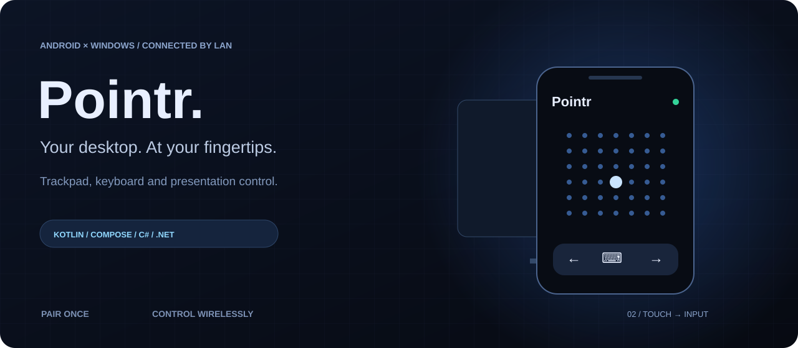
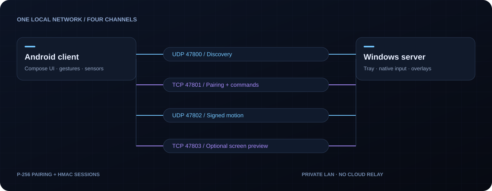

<div align="center">



[](https://github.com/xarmaq/Pointr/actions/workflows/ci.yml)


[](LICENSE)

**A trackpad. A presentation remote. In your pocket.**

Turn an Android phone into a wireless controller for a Windows PC over your local network.

[Features](#features) · [Components](#components) · [Get started](#get-started) · [Build](#build-from-source) · [Protocol](#protocol)

</div>

## Overview

Pointr pairs a Kotlin / Jetpack Compose phone app with a small .NET Windows tray server. Discover your PC, confirm a four-digit code and control the desktop from the phone. Discovery, commands, pointer motion and optional screen preview use separate local network channels.

**Status: early project, version 1.0.0 in the source manifests.** There is no store distribution or automated end-to-end device test suite yet. Build instructions below are the canonical way to obtain the apps.

## Features

| Control | Included behavior |
| --- | --- |
| Trackpad | Pointer movement, clicks, dragging and scrolling |
| Keyboard | Text and keyboard input from the phone |
| Presentations | Slide navigation, gyroscope-driven laser and a desktop blur overlay |
| Media | Playback controls, volume and mute |
| Windows | Browse and focus desktop windows |
| Screen preview | Optional live monitor preview beneath the trackpad, controlled from the PC |
| Personalization | Accent colors, haptics and English / Russian interface resources |

## Components



| Component | Responsibility |
| --- | --- |
| [`android/`](android/) | Kotlin, Jetpack Compose, Android 10+ client |
| [`ui/Trackpad.kt`](android/app/src/main/java/app/pointr/ui/Trackpad.kt) | Touch gestures and pointer interaction |
| [`ui/GyroLaser.kt`](android/app/src/main/java/app/pointr/ui/GyroLaser.kt) | Sensor-based presentation pointer |
| [`net/`](android/app/src/main/java/app/pointr/net/) | Discovery, pairing, sessions and network transport |
| [`windows/Pointr.Server/`](windows/Pointr.Server/) | .NET 8 WinForms tray application |
| `InputService`, `AudioService`, `WindowService` | Native desktop input, audio and window control |
| `LaserOverlay`, `BlurOverlay`, `ScreenStreamer` | Presentation overlays and optional monitor streaming |
| [`tools/`](tools/) | Icon generation and drawable conversion utilities |

The illustrations above are explanatory vector artwork, not application screenshots.

## Get started

1. Build the Windows server and Android APK using the commands below.
2. Run `Pointr.exe` on the PC. Allow access through Windows Firewall on your **private network**. The server lives in the system tray.
3. Install the APK on your phone and connect both devices to the same Wi-Fi / LAN.
4. Select the PC in the app, or enter its IP from the tray menu.
5. Enter the four-digit PIN shown on the PC. Pairing is remembered for future sessions.

Enable screen sharing in the PC tray settings only when you want a monitor preview. Use the tray controls to manage paired devices.

## Build from source

### Windows server

Install the .NET 8 SDK on Windows, then run from the repository root:

```powershell
git clone https://github.com/xarmaq/Pointr.git
cd Pointr
dotnet restore windows/Pointr.Server
dotnet build windows/Pointr.Server -c Release
dotnet publish windows/Pointr.Server -c Release -o dist/windows
```

The project targets `net8.0-windows` / `win-x64` and publishes a self-contained single executable. The target PC does not need a separate .NET runtime installation.

### Android app

Use Android Studio or a compatible JDK (17+; CI uses 21), Android SDK platform 36 and the included Gradle wrapper. Set `ANDROID_HOME` or create an untracked `android/local.properties` with `sdk.dir` pointing to your SDK.

```powershell
cd android
.\gradlew.bat assembleDebug lintDebug
.\gradlew.bat assembleRelease
```

Debug APK: `android/app/build/outputs/apk/debug/app-debug.apk`.
Release APK: `android/app/build/outputs/apk/release/app-release.apk`.

The current release build is signed with the local **debug key** for sideloading. Configure your own release keystore before store distribution; signing keys and machine-specific SDK paths must stay out of Git. A debug-signed APK built on another machine may require uninstalling a previously installed build first.

## Protocol

| Port | Transport | Role |
| --- | --- | --- |
| `47800` | UDP | LAN discovery: `PNTR_DISCOVER` and a server JSON response |
| `47801` | TCP | JSON-lines handshake, PIN pairing, commands and state updates |
| `47802` | UDP | 26-byte HMAC-signed movement, scrolling and laser packets |
| `47803` | TCP | Authorized screen preview: cursor records and JPEG frames with client acknowledgments |

Pairing uses P-256 ECDH with PIN confirmation. Later sessions use HMAC challenge authentication and a derived session key for motion packets. Screen streaming requires a session proof and the PC-side sharing setting. Authentication does **not** mean the application traffic is TLS-encrypted: use a trusted private network and do not expose these ports to the internet.

Implementation details are in [`Server.cs`](windows/Pointr.Server/Server.cs), [`ScreenStreamer.cs`](windows/Pointr.Server/ScreenStreamer.cs) and the Android [`net/`](android/app/src/main/java/app/pointr/net/) package.

## Troubleshooting

| Symptom | Check |
| --- | --- |
| PC is not discovered | Same subnet, private-network firewall access, and Wi-Fi client isolation; try manual IP entry |
| Input does not reach an elevated app | Windows privilege boundaries can block input from a lower-privilege server |
| Screen preview is empty | Enable screen sharing in the PC tray settings and check TCP port `47803` |
| APK will not update | Build signing keys may differ; back up anything needed before uninstalling the old app |

## Development

GitHub Actions builds the Windows server and runs the Android debug build and lint. On real devices, verify discovery, new pairing, reconnection, trackpad input, presentation controls and screen-sharing permission changes. CI does not validate sensor behavior or network latency.

See [CONTRIBUTING.md](CONTRIBUTING.md) to contribute. Source code uses the [MIT license](LICENSE); bundled fonts and icons have their own licenses listed in [THIRD_PARTY_NOTICES.md](THIRD_PARTY_NOTICES.md).
